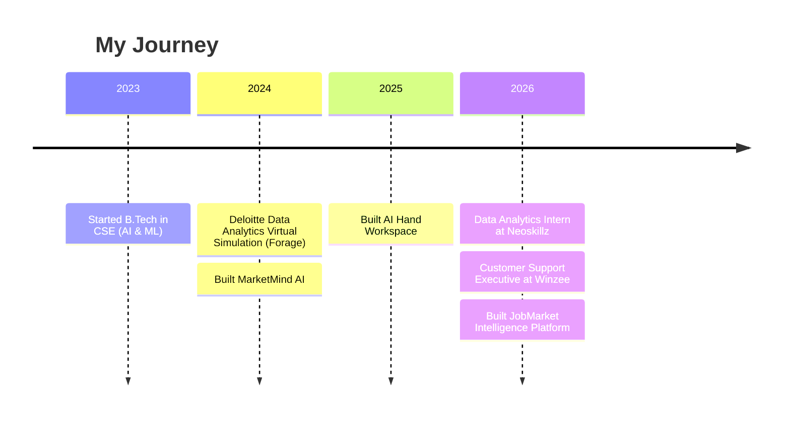
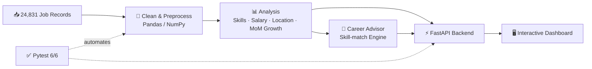

<div align="center">

<h1>Gaddam Srija</h1>
<h3>📊 Data Analyst &nbsp;|&nbsp; 🎓 B.Tech CSE (AI &amp; ML) &nbsp;|&nbsp; 📍 Hyderabad, India</h3>

<!-- Animated typing text. Edit lines= (use + for spaces, ; between lines) -->
<a href="https://srija-portfolio-rho.vercel.app/">
  
</a>

<br/><br/>

[](https://srija-portfolio-rho.vercel.app/)
[](https://linkedin.com/in/gaddam-srija-749230325)
[](https://x.com/Srijj05)
[](mailto:gaddamsrija005@gmail.com)


</div>

---

## 👩‍💻 About Me

<table>
<tr>
<td width="60%" valign="top">

<!-- UPDATE: Edit your bio here -->
I'm a final-year B.Tech CSE (AI & ML) student in Hyderabad with a passion for turning raw data into clear, actionable insights. I enjoy working with Python, SQL, and Power BI, and recently built a Job Market Intelligence platform that analyzes **24,000+ job records**. I'm currently looking for an entry-level Data Analyst role where I can grow while solving real business problems with data.

🎯 **Career Goals:** I'm looking for an entry-level **Data Analyst** role (or a Data Analytics internship) where I can apply my skills in Python, SQL, and Power BI to uncover insights and support data-driven decisions. Long term, I want to grow into a role that blends analytics with machine learning, helping teams turn data into smart, impactful solutions.

</td>
<td width="40%" valign="top">

```yaml
name:      Gaddam Srija
role:      Student → Data Analyst
education: B.Tech CSE (AI & ML)
college:   Sri Indu Institute of Engg & Tech
graduating: 2027
location:  Hyderabad, India
interests:
  - Data Visualization
  - Machine Learning
  - AI / Generative AI
learning:
  - AWS
  - Advanced Python Libraries
```

</td>
</tr>
</table>

> 🎮 **Fun fact:** I've analyzed customer data on an online gaming platform, led a team at the Smart India Hackathon, and built a gesture-controlled workspace that lets me control my computer with just my hands, no mouse needed!

---

## 🛠️ Tech Stack

<!-- UPDATE: Icons come from skillicons.dev. Add or remove names in i=...  (full list: https://skillicons.dev) -->

<div align="center">

**Languages & Data**


**Backend, Tools & Platforms**


</div>

<details>
<summary><b>📋 Full skill breakdown (click to expand)</b></summary>
<br/>

| Category | Skills |
|---|---|
| **Data Analysis** | Python, Pandas, NumPy, SQL, Data Cleaning, Preprocessing, EDA, Statistical Analysis |
| **Visualization** | Power BI, Excel, Matplotlib, Seaborn, Dashboard-Ready Metrics |
| **Database & Backend** | MySQL, Joins, Aggregations, Filtering, Grouping, FastAPI, Pytest |
| **Machine Learning** | Scikit-learn, Feature Engineering, Encoding, Feature Scaling, Polynomial Features, PCA |
| **NLP & AI** | Text Preprocessing, NLP, Generative AI, Prompt Engineering, Computer Vision |
| **Tools** | Google Colab, Jupyter Notebook, Git/GitHub, VS Code, MySQL Workbench |

</details>

---

## 💼 Experience



<details open>
<summary><b>📊 Data Analytics Intern, Neoskillz (2026, 2 months)</b></summary>

- Explored, cleaned, and preprocessed structured datasets using Python, SQL, and Pandas
- Performed EDA and visualized trends with Matplotlib and Seaborn
- Practiced feature engineering: encoding, feature scaling, and PCA
- Hands-on MySQL query writing and joins; foundational training in NLP and Generative AI

</details>

<details>
<summary><b>🎧 Customer Support Executive, Winzee (May – Jun 2026)</b></summary>

- Tracked and analyzed high-volume customer interaction data to find recurring patterns
- Applied data-driven problem-solving to improve resolution speed and accuracy
- Reported issue trends to cross-functional teams

</details>

---

## 🚀 Featured Projects

<!-- UPDATE: Replace each repo link with the exact URL, e.g. https://github.com/SrijaGaddam05/your-repo-name -->

<table>
<tr>
<td width="50%" valign="top">

### 📊 JobMarket Intelligence
**Data Analytics Platform**

Analyzed **24,831 job records** for hiring trends, in-demand skills, salary benchmarks, and location insights. Includes a Career Advisor with **90.6% baseline skill matching** for Data Analyst roles and an interactive dashboard (Pytest: 6/6 passing).

`Python` `Pandas` `NumPy` `FastAPI` `JavaScript` `Pytest`

[](https://github.com/SrijaGaddam05?tab=repositories)

</td>
<td width="50%" valign="top">

### 🧠 MarketMind AI
**Marketing Data Analytics Platform**

Sentiment analysis, trend visualization, and sales forecasting on marketing datasets. Applied NLP (tokenization, feature extraction) to classify customer feedback and delivered stakeholder-ready insight reports.

`Python` `NLP` `Pandas` `Matplotlib` `Seaborn`

[](https://github.com/SrijaGaddam05?tab=repositories)

</td>
</tr>
<tr>
<td width="50%" valign="top">

### 🖐️ AI Hand Workspace
**Computer Vision & Generative AI System**

Real-time gesture-based productivity system with low-latency, concurrent inference. Uses the Google GenAI API with prompt engineering and function-calling for intelligent, automated feature activation.

`Python` `OpenCV` `MediaPipe` `Google GenAI API`

[](https://github.com/SrijaGaddam05?tab=repositories)

</td>
<td width="50%" valign="top">

### 🏢 Deloitte Data Analytics Simulation
**Forage Virtual Experience**

Analyzed real-world structured datasets to identify patterns and generate insight reports, then delivered stakeholder-facing summaries with clear business recommendations.

`Data Analysis` `Reporting` `Business Insights`

[](https://srija-portfolio-rho.vercel.app/)

</td>
</tr>
</table>

### 🔄 How JobMarket Intelligence Works



---

## 📈 GitHub Analytics

<div align="center">


<br/>


<br/>


<br/>


</div>

<!--
OPTIONAL: Animated contribution snake.
1. Add the file .github/workflows/snake.yml (included with this README)
2. In your repo go to Actions → "Generate Snake" → Run workflow
3. Once it finishes, delete the <!-- and --> markers around the image below

<div align="center">
  
</div>
-->

---

## 🏆 Achievements & Certifications

<!-- UPDATE: Add new certifications here -->

| | Achievement |
|---|---|
| 📗 | **Microsoft Office Specialist** (Excel, Word, PowerPoint) |
| 🗄️ | **MySQL Using AI Certification**: queries, joins, aggregations, AI-assisted database tasks |
| 🐍 | **Python Essentials 2**: Cisco Networking Academy with OpenEDG Python Institute (Sep 2026) |
| ☕ | **Apna College Alpha Program**: DSA with Java, 50+ LeetCode problems solved |
| 🏅 | **Smart India Hackathon**: Team Leader |
| 🚀 | **NxtWave Buildathon**: Participant |
| 🎤 | **Academic Poster Presenter** (AI/ML) |
| 💼 | **Deloitte Data Analytics Virtual Simulation** (Forage) |

---

## 📚 Currently Learning &nbsp;&amp;&nbsp; 🤝 Open to Collaborate

<table>
<tr>
<td width="50%" valign="top">

### 📚 Learning
- ☁️ **AWS**
- 🐍 **Advanced Python Libraries** (like Seaborn)

</td>
<td width="50%" valign="top">

### 🤝 Collaborate On
- 📊 **Data analytics projects**: dashboards, EDA, insight reports
- 🌐 **Open-source projects**: Python and data tooling
- 🤖 **ML & Generative AI**: NLP, computer vision, AI tools
- 🎓 **Research projects**: AI/ML and data science

</td>
</tr>
</table>

---

## 📬 Connect With Me

<div align="center">

[](https://srija-portfolio-rho.vercel.app/)
[](https://linkedin.com/in/gaddam-srija-749230325)
[](https://x.com/Srijj05)
[](mailto:gaddamsrija005@gmail.com)
[](https://github.com/SrijaGaddam05)

<br/>

**⭐ Thanks for visiting! Let's turn data into insights together. ⭐**

</div>
