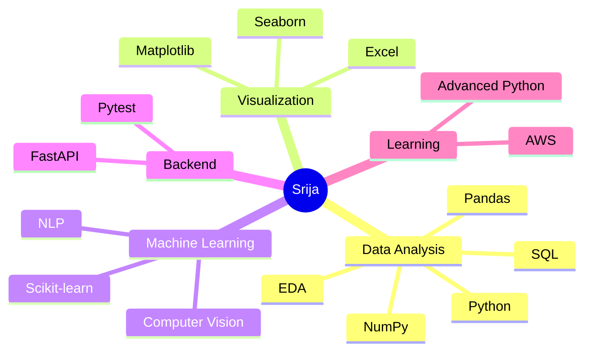
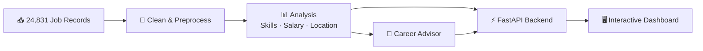
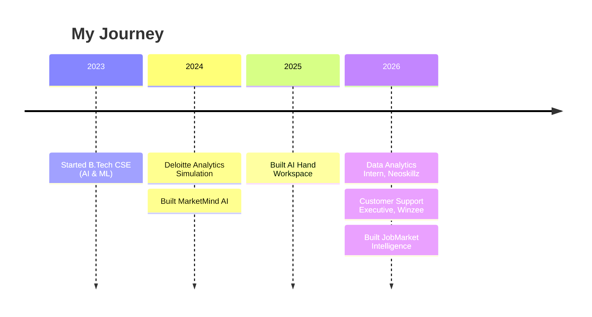
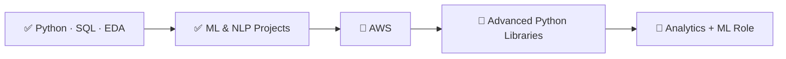

## 👩‍💻 About Me

I turn messy data into clear decisions. Final-year B.Tech student (CSE, AI & ML), Data Analytics intern at Neoskillz, and Team Leader at the Smart India Hackathon.

- 🔭 **Built:** a Job Market Intelligence platform on 24,000+ job records
- 🌱 **Learning:** AWS and advanced Python libraries
- 🎯 **Looking for:** an entry-level Data Analyst role or analytics internship
- 🚀 **Long term:** analytics + machine learning, building smart tools that help teams decide
- 🎮 **Fun fact:** I built a gesture-controlled workspace. No mouse needed.

## 💡 What I Bring

- 🧹 **Data cleaning:** turning messy datasets into analysis-ready data (Pandas, NumPy, SQL)
- 🔍 **EDA & statistics:** finding trends, patterns and outliers
- 📊 **Reporting:** clear visuals and insight summaries (Matplotlib, Seaborn, Excel)
- 🗄️ **SQL:** joins, aggregations, filtering and grouping in MySQL
- 🤖 **ML & NLP prototypes:** Scikit-learn models, sentiment analysis, computer vision
- 🗣️ **Communication:** reported trends to teams (Winzee), presented to stakeholders (Deloitte), led a team (Smart India Hackathon)

### 🧭 Skill Map

## 🛠️ Tech Stack

**Languages** 

**Data & Machine Learning** 

**Backend & Tools** 

## 🚀 Featured Projects

### 📊 JobMarket Intelligence: Data Analytics Platform
- **What I Did:** Analyzed 24,831 job records for hiring trends, in-demand skills, salaries, and locations. Built a Career Advisor and an interactive dashboard.
- **Tools:** `Python` `Pandas` `NumPy` `FastAPI` `JavaScript` `Pytest`
- **Impact:** 90.6% baseline skill matching for Data Analyst roles; 6/6 tests passing.

### 🧠 MarketMind AI: Marketing Analytics Platform
- **What I Did:** Ran sentiment analysis, trend visualization, and sales forecasting on marketing data.
- **Tools:** `Python` `NLP` `Pandas` `Matplotlib` `Seaborn`
- **Impact:** Classified customer feedback with NLP and delivered stakeholder-ready insight reports.

### 🖐️ AI Hand Workspace: Computer Vision & GenAI
- **What I Did:** Built a real-time gesture-based productivity system with concurrent, low-latency inference.
- **Tools:** `Python` `OpenCV` `MediaPipe` `Google GenAI API`
- **Impact:** Hands-free computer control with prompt-engineered, function-calling automation.

### 🏢 Deloitte Data Analytics Simulation (Forage)
- **What I Did:** Analyzed real-world structured datasets and presented findings to stakeholders.
- **Tools:** `Data Analysis` `Reporting` `Business Insights`
- **Impact:** Delivered clear business recommendations from pattern analysis.

## 💼 Experience

<b>📊 Data Analytics Intern, Neoskillz (2026 · 2 months)</b>

- Cleaned and preprocessed structured datasets with Python, SQL, and Pandas
- Ran EDA and visualized trends with Matplotlib and Seaborn
- Practiced feature engineering: encoding, scaling, PCA
- Wrote MySQL queries and joins; trained in NLP and Generative AI

<b>🎧 Customer Support Executive, Winzee (May – Jun 2026)</b>

- Analyzed high-volume customer interaction data to spot recurring issues
- Improved resolution speed and accuracy with data-driven problem solving
- Reported issue trends to cross-functional teams

## 📈 GitHub Analytics

## 🏆 Achievements & Certifications

- 📗 **Microsoft Office Specialist** (Excel, Word, PowerPoint)
- 🗄️ **MySQL Using AI Certification**
- 🐍 **Python Essentials 2**, Cisco Networking Academy × OpenEDG (Sep 2026)
- ☕ **Apna College Alpha Program:** DSA with Java, 50+ LeetCode problems
- 🏅 **Smart India Hackathon:** Team Leader
- 🚀 **NxtWave Buildathon:** Participant
- 🎤 **Academic Poster Presenter** (AI/ML)
- 💼 **Deloitte Data Analytics Simulation** (Forage)

## 🌱 Growth Roadmap

## 🤝 Open to Collaborate On

- 📊 Dashboards, EDA, and insight reports
- 🌐 Open-source Python and data tooling
- 🤖 NLP, computer vision, and Generative AI
- 🎓 AI/ML research projects

## 📫 Let's Work Together

I'm open to entry-level Data Analyst roles and analytics internships. If you have a data problem, I'd love to hear about it.

**⭐ Let's turn data into insights together. ⭐**

