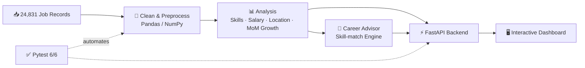

<table>
<tr>
<td align="center" width="240">

<!-- PHOTO: photo is profile.png in the repo root.
     GitHub strips CSS, so crop it into a circle in your editor (or Canva) before uploading. -->

</td>
<td align="left" valign="middle">

# Gaddam Srija
### 📊 Aspiring Data Analyst · 🎓 B.Tech CSE (AI & ML) · 📍 Hyderabad

**I turn raw data into decisions.**
Python · SQL · Pandas · Machine Learning

🟢 *Open to entry-level Data Analyst roles & analytics internships*

</td>
</tr>
</table>

---

## ⚡ At a Glance

| 24,831 | 90.6% | 6/6 | 2027 |
|:---:|:---:|:---:|:---:|
| job records analyzed | skill-match accuracy (baseline) | Pytest tests passing | graduating |

---

## 👩‍💻 About Me

Final-year B.Tech student who loves finding the story hidden in data. I recently built a **Job Market Intelligence platform** on **24,000+ job records**, interned in data analytics at Neoskillz, and led a team at the **Smart India Hackathon**.

🎯 **Goal:** an entry-level Data Analyst role (or analytics internship) where I can use Python and SQL to support real business decisions, then grow toward analytics + machine learning.

> 🎮 **Fun fact:** I built a gesture-controlled workspace that lets me run my computer with just my hands. No mouse needed.

---

## 🛠️ Tech Stack

<b>📋 Full skill breakdown</b>

 

| Category | Skills |
|---|---|
| **Data Analysis** | Python, Pandas, NumPy, SQL, Data Cleaning, EDA, Statistical Analysis |
| **Visualization** | Excel, Matplotlib, Seaborn |
| **Database & Backend** | MySQL, Joins, Aggregations, FastAPI, Pytest |
| **Machine Learning** | Scikit-learn, Feature Engineering, Encoding, Scaling, PCA |
| **NLP & AI** | Text Preprocessing, NLP, Generative AI, Prompt Engineering, Computer Vision |
| **Tools** | Google Colab, Jupyter, Git/GitHub, VS Code, MySQL Workbench |

---

## 🚀 Featured Projects

<table>
<tr>
<td width="50%" valign="top">

### 📊 JobMarket Intelligence
**Data Analytics Platform**

**What I Did:** Analyzed 24,831 job records for hiring trends, skills demand, salaries, and locations. Built a Career Advisor and interactive dashboard.
**Tools:** `Python` `Pandas` `NumPy` `FastAPI` `JavaScript` `Pytest`
**Impact:** 90.6% baseline skill matching for Data Analyst roles; 6/6 tests passing.

</td>
<td width="50%" valign="top">

### 🧠 MarketMind AI
**Marketing Analytics Platform**

**What I Did:** Ran sentiment analysis, trend visualization, and sales forecasting on marketing data.
**Tools:** `Python` `NLP` `Pandas` `Matplotlib` `Seaborn`
**Impact:** Classified customer feedback with NLP and delivered stakeholder-ready insight reports.

</td>
</tr>
<tr>
<td width="50%" valign="top">

### 🖐️ AI Hand Workspace
**Computer Vision & GenAI**

**What I Did:** Built a real-time gesture-based productivity system with concurrent, low-latency inference.
**Tools:** `Python` `OpenCV` `MediaPipe` `Google GenAI API`
**Impact:** Hands-free control with prompt-engineered, function-calling automation.

</td>
<td width="50%" valign="top">

### 🏢 Deloitte Analytics Simulation
**Forage Virtual Experience**

**What I Did:** Analyzed real-world structured datasets and presented findings to stakeholders.
**Tools:** `Data Analysis` `Reporting` `Business Insights`
**Impact:** Delivered clear business recommendations from pattern analysis.

</td>
</tr>
</table>

### 🔄 How JobMarket Intelligence Works

---

## 💼 Experience

<b>📊 Data Analytics Intern, Neoskillz (2026 · 2 months)</b>

- Cleaned and preprocessed structured datasets with Python, SQL, and Pandas
- Ran EDA and visualized trends with Matplotlib and Seaborn
- Practiced feature engineering: encoding, scaling, PCA
- Wrote MySQL queries and joins; trained in NLP and Generative AI

<b>🎧 Customer Support Executive, Winzee (May – Jun 2026)</b>

- Analyzed high-volume customer interaction data to spot recurring issues
- Improved resolution speed and accuracy with data-driven problem solving
- Reported issue trends to cross-functional teams

---

## 📈 GitHub Analytics

---

## 🏆 Achievements & Certifications

| | Achievement |
|---|---|
| 📗 | **Microsoft Office Specialist** (Excel, Word, PowerPoint) |
| 🗄️ | **MySQL Using AI Certification** |
| 🐍 | **Python Essentials 2**, Cisco Networking Academy × OpenEDG (Sep 2026) |
| ☕ | **Apna College Alpha Program**: DSA with Java, 50+ LeetCode problems |
| 🏅 | **Smart India Hackathon**: Team Leader |
| 🚀 | **NxtWave Buildathon**: Participant |
| 🎤 | **Academic Poster Presenter** (AI/ML) |
| 💼 | **Deloitte Data Analytics Simulation** (Forage) |

---

## 📚 Learning & 🤝 Collaborating

<table>
<tr>
<td width="50%" valign="top">

### 📚 Learning
- ☁️ AWS
- 🐍 Advanced Python libraries

</td>
<td width="50%" valign="top">

### 🤝 Open to Collaborate On
- 📊 Dashboards, EDA, insight reports
- 🌐 Open-source Python & data tooling
- 🤖 NLP, computer vision, GenAI
- 🎓 AI/ML research

</td>
</tr>
</table>

---

**⭐ Thanks for visiting. Let's turn data into insights together. ⭐**

